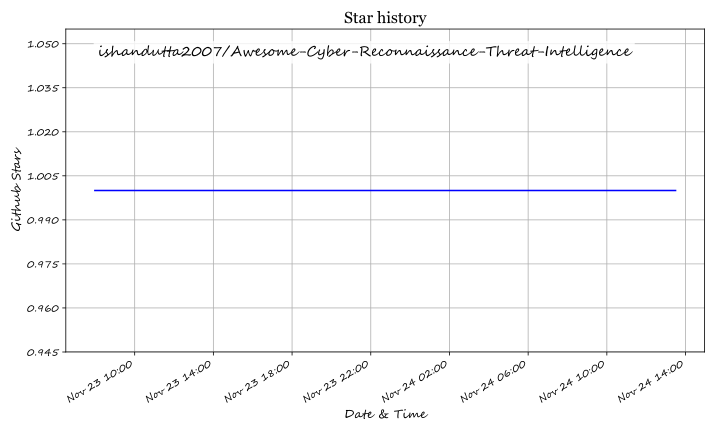

<p align="center">
  
</p>

# 🌐 Awesome Cyber Reconnaissance & Threat Intelligence 🛡️

<p align="center">
  <a href="https://github.com/ishandutta2007/Awesome-Awesome-Awesome"></a>
  <a href="https://discord.gg/jc4xtF58Ve"></a>
  <a href="https://github.com/ishandutta2007/Awesome-Cyber-Reconnaissance-Threat-Intelligence/stargazers"></a>
  <a href="https://github.com/ishandutta2007/Awesome-Cyber-Reconnaissance-Threat-Intelligence/network/members"></a>
  <a href="https://github.com/ishandutta2007/Awesome-Cyber-Reconnaissance-Threat-Intelligence/issues"></a>
  <a href="https://github.com/ishandutta2007/Awesome-Cyber-Reconnaissance-Threat-Intelligence/blob/main/LICENSE"></a>
  <a href="https://github.com/ishandutta2007"></a>
</p>

---

## 🎯 Overview & Introduction

A curated repository of top-tier **Cyber Reconnaissance & Threat Intelligence** solutions, bridging enterprise-grade **SaaS / Hosted Platforms** and high-velocity **Open-Source GitHub Projects**.

Modern cybersecurity operations demand real-time situational awareness. Whether conducting external attack surface management (EASM), tracking active threat actors, mapping cyber adversary infrastructure, or uncovering exposed credentials and indicators of compromise (IOCs), this ecosystem guide covers every essential tool for SOC defenders, incident responders, red/blue teamers, and security researchers.

---

## 📑 Table of Contents

- [📊 Sector Overview & Market Dynamics](#-sector-overview--market-dynamics)
- [🏢 SaaS & Hosted Threat Reconnaissance Platforms](#-saas--hosted-threat-reconnaissance-platforms)
- [💻 Open-Source GitHub Projects](#-open-source-github-projects)
- [🛠️ Recommended Recon & Threat Intel Architecture](#️-recommended-recon--threat-intel-architecture)
- [🤝 How to Contribute](#-how-to-contribute)
- [💖 Support & Community](#-support--community)
- [⚖️ Legal Disclaimer](#️-legal-disclaimer)
- [📈 Star History](#-star-history)

---

## 📊 Sector Overview & Market Dynamics

The global **Threat Intelligence & Attack Surface Management (EASM)** market is estimated at **$13.5 Billion - $15.2 Billion**, experiencing rapid double-digit compound annual growth (CAGR ~16-18%) fueled by cloud adoption, hybrid workforce perimeters, and sophisticated nation-state attack campaigns.

The sector is **moderately fragmented**: broad telemetry aggregation and core threat feeds see strong consolidation around tier-1 cloud and cyber security giants (such as Google Threat Intelligence/Mandiant, Recorded Future, and Palo Alto Networks), while specialized reconnaissance domains (such as dark web surveillance, attack surface mapping, visual link analysis, and specialized OSINT enrichment) foster a highly active, competitive ecosystem of specialized vendors and agile open-source engines.

---

## 🏢 SaaS & Hosted Threat Reconnaissance Platforms

Below is an overview of top commercial cyber reconnaissance, threat intelligence, and attack surface discovery platforms, ordered by company scale (valuation and annual revenue).

| 🏢 Platform | 📝 Focus & Primary Capabilities | 💰 Pricing (Starting Paid Tier) | 🎁 Free Tier / Trial Limits | 📈 Company Scale (Valuation / Revenue) |
| :--- | :--- | :--- | :--- | :--- |
| **[VirusTotal Enterprise (Google Threat Intelligence)](https://virustotal.com)** | Malware intelligence, URL/domain IOC sandboxing, multi-engine AV analysis, and Threat Graph hunting. | **$10,000 / year** (~$833/month) for enterprise API and threat hunting access. | **Free Community Plan**: 500 requests/day, 4 lookups/minute public API rate limit; basic file & URL scans. | **~$2.1 Trillion Parent Valuation** (Alphabet / Google; Mandiant & VT division >$500M+ revenue) |
| **[Recorded Future](https://recordedfuture.com)** | Enterprise intelligence cloud unifying open web, dark web, technical telemetry, geopolitical risk, and automated SOAR triage. | **$30,000 / year** enterprise starting subscription based on intelligence modules. | **Free Trial by Request**: 14-day enterprise evaluation with custom analyst onboarding and limited query access. | **$2.65 Billion Valuation** (Acquired by Mastercard; ~$350M+ ARR) |
| **[Censys](https://censys.com)** | Global internet scanner, external Attack Surface Management (ASM), and continuous cloud asset/certificate tracking. | **$1,200 / year** ($100/month) for Starter Data API plan. | **Free Community Plan**: 250 search queries/month, 5,000 API query results/month, perpetual access. | **~$350 Million Valuation** ($125M+ raised from Decibel, GV, Intel Capital; ~$45M ARR) |
| **[Shodan & Shodan Enterprise](https://shodan.io)** | Internet-wide device search engine indexing open TCP/UDP ports, services, banners, SSL certificates, and ICS/SCADA systems. | **$69 / month** for Membership / Freelancer API tier; one-time **$49** lifetime basic query account. | **Free Registered Account**: 20 query results per search; no API scan credits until upgraded. | **~$100 Million+ Valuation** (Self-funded, highly profitable market standard; estimated $25M-$40M ARR) |
| **[Maltego](https://maltego.com)** | Visual link analysis, graph-based OSINT investigations, and transform-hub connecting hundreds of external threat databases. | **$999 / year** (~$83/month) for Maltego Classic (now Maltego Pro desktop). | **Free Community Edition (CE)**: Free forever, limited to 12 results per transform execution. | **~$90 Million Valuation** (Acquired by Charlesbank Technology Opportunities; estimated $20M+ revenue) |
| **[WhoisXML API](https://whoisxmlapi.com)** | WHOIS domain registry databases, DNS passive history, reverse IP lookups, and real-time newly registered domain (NRD) feeds. | **$29 / month** for 1,000 monthly API queries and WHOIS data lookups. | **Free Forever Plan**: 500 free queries/month across WHOIS and DNS APIs upon email registration. | **~$50 Million Valuation** (Bootstrapped enterprise data provider; estimated $12M-$18M ARR) |
| **[DarkOwl](https://darkowl.com)** | Premier darknet intelligence engine crawling Tor, I2P, ZeroNet, encrypted chats, and underground forums for credential breaches. | **$12,000 / year** (~$1,000/month) minimum starting commercial access for DarkOwl Vision. | **Free Trial**: 7-day guided corporate evaluation for verified enterprise and law enforcement domains. | **~$35 Million Valuation** ($15M+ funding; estimated $8M-$12M ARR) |
| **[Intelligence X (IntelX)](https://intelx.io)** | Search engine and archive indexing Tor onion domains, paste sites, data breach dumps, and historical public records. | **€3,000 / year** (~$3,250/year) for Professional Tier access with full selector search. | **Free Tier**: 10 searches per day with obfuscated and partially redacted search preview results. | **~$20 Million Valuation** (Independent European cyber intel firm; estimated $4M-$7M ARR) |
| **[SecurityTrails](https://securitytrails.com)** | Historical DNS records, domain ownership changes, passive DNS graphs, and enterprise attack surface footprinting APIs. | **$50 / month** for Developer API access (5,000 queries/month). | **Free API Tier**: 50 free queries per month with basic historical DNS lookups. | **~$15 Million Valuation** (Acquired subsidiary of Recorded Future; operates independent data feed) |
| **[SpiderFoot HX](https://spiderfoot.net)** | Hosted multi-target OSINT automation platform offering continuous monitoring, dark-web scans, and correlation alerts. | **$49 / month** for Freelancer Plan (25 active investigations, 2,500 results/scan). | **14-Day Free Trial**: Full access to cloud scanners with up to 3 concurrent investigations. | **~$5 Million Valuation** (Independent SaaS spin-off of the open-source SpiderFoot framework) |

---

## 💻 Open-Source GitHub Projects

Curated list of the most impactful open-source intelligence (OSINT), external reconnaissance, attack surface discovery, and threat platform repositories — ranked by GitHub Stars_Count ⭐.

| 📦 Repository & Project | ⭐ GitHub_Stars | 🛠️ Category & Primary Use Case |
| :--- | :--- | :--- |
| **[Sherlock](https://github.com/sherlock-project/sherlock)** [](https://github.com/sherlock-project/sherlock/stargazers) | `116,400+` | 🕵️ **Social OSINT**: Hunt down target usernames and digital personas across 400+ social platforms. |
| **[Maigret](https://github.com/soxoj/maigret)** [](https://github.com/soxoj/maigret/stargazers) | `41,200+` | 🔍 **Dossier Generation**: Advanced username reconnaissance gathering aliases, IDs, and dossier reports. |
| **[Gitleaks](https://github.com/gitleaks/gitleaks)** [](https://github.com/gitleaks/gitleaks/stargazers) | `31,300+` | 🔑 **Secret Detection**: Audit Git repositories for hardcoded secrets, API tokens, and exposed credentials. |
| **[TruffleHog](https://github.com/trufflesecurity/trufflehog)** [](https://github.com/trufflesecurity/trufflehog/stargazers) | `29,600+` | 🛡️ **Credential Recon**: High-throughput scanner detecting active secrets in source code, S3 buckets, and logs. |
| **[Masscan](https://github.com/robertdavidgraham/masscan)** [](https://github.com/robertdavidgraham/masscan/stargazers) | `26,100+` | ⚡ **Port Scanning**: Asynchronous TCP port scanner capable of scanning the entire internet in under 5 minutes. |
| **[SpiderFoot](https://github.com/smicallef/spiderfoot)** [](https://github.com/smicallef/spiderfoot/stargazers) | `24,900+` | 🤖 **Automated OSINT**: Comprehensive reconnaissance automation engine combining 200+ data sources. |
| **[theHarvester](https://github.com/laramies/theHarvester)** [](https://github.com/laramies/theHarvester/stargazers) | `18,400+` | 📧 **OSINT Harvester**: Gather subdomains, emails, employee titles, and open ports from search engines and PGP. |
| **[OWASP Amass](https://github.com/owasp-amass/amass)** [](https://github.com/owasp-amass/amass/stargazers) | `15,500+` | 🌐 **Attack Surface Mapping**: In-depth network mapping, DNS enumeration, and graph-based asset discovery. |
| **[Subfinder](https://github.com/projectdiscovery/subfinder)** [](https://github.com/projectdiscovery/subfinder/stargazers) | `14,800+` | ⚡ **Passive Subdomain Enumeration**: Fast Go tool querying dozens of passive DNS and CT log feeds. |
| **[Nmap](https://github.com/nmap/nmap)** [](https://github.com/nmap/nmap/stargazers) | `14,000+` | 🎯 **Network Scanner**: Industry standard network discovery, vulnerability scanning, and service fingerprinting. |
| **[BBOT](https://github.com/blacklanternsecurity/bbot)** [](https://github.com/blacklanternsecurity/bbot/stargazers) | `11,200+` | 🔄 **Recursive Recon**: Modular OSINT framework for recursive DNS, port, web, and cloud asset mapping. |
| **[httpx](https://github.com/projectdiscovery/httpx)** [](https://github.com/projectdiscovery/httpx/stargazers) | `10,600+` | 🚀 **HTTP Probing**: Multi-purpose HTTP toolkit running rapid probe requests, status checks, and TLS extractions. |
| **[OpenCTI](https://github.com/OpenCTI-Platform/opencti)** [](https://github.com/OpenCTI-Platform/opencti/stargazers) | `10,400+` | 🛡️ **Cyber Threat Intelligence (TIP)**: Unified platform for managing STIX 2.1 threat actors, campaigns, and IOCs. |
| **[MISP](https://github.com/MISP/MISP)** [](https://github.com/MISP/MISP/stargazers) | `6,700+` | 🤝 **Threat Sharing Platform**: Open-source platform for sharing, correlating, and storing cyber threat intelligence. |
| **[Naabu](https://github.com/projectdiscovery/naabu)** [](https://github.com/projectdiscovery/naabu/stargazers) | `6,400+` | ⚡ **Fast Port Scanner**: Fast, reliable SYN/CONNECT port scanner focused on stealth and pipeline composability. |
| **[Recon-ng](https://github.com/lanmaster53/recon-ng)** [](https://github.com/lanmaster53/recon-ng/stargazers) | `6,000+` | 🛠️ **Web Recon Framework**: Metasploit-like modular web OSINT framework with interactive workspace database. |
| **[Aquatone](https://github.com/michenriksen/aquatone)** [](https://github.com/michenriksen/aquatone/stargazers) | `5,900+` | 📸 **Visual Reconnaissance**: Automated visual inspection and clustering of HTTP services across domain targets. |
| **[IntelOwl](https://github.com/intelowlproject/IntelOwl)** [](https://github.com/intelowlproject/IntelOwl/stargazers) | `4,800+` | 🦉 **Threat Orchestration**: Orchestrate 150+ threat intelligence feeds (VirusTotal, AbuseIPDB, Shodan) in one API. |
| **[GoWitness](https://github.com/sensepost/gowitness)** [](https://github.com/sensepost/gowitness/stargazers) | `4,500+` | 📷 **Web Screenshot Utility**: Headless Chrome web screenshot and visual attack surface auditing utility. |
| **[IVRE](https://github.com/ivre/ivre)** [](https://github.com/ivre/ivre/stargazers) | `4,200+` | 🗺️ **Network Recon Framework**: Self-hosted internet recon tool integrating Nmap, Masscan, Zeek, and DNS history. |
| **[MassDNS](https://github.com/blechschmidt/massdns)** [](https://github.com/blechschmidt/massdns/stargazers) | `3,600+` | ⚡ **High-Speed DNS Resolver**: High-performance stub resolver resolving millions of domain names per minute. |
| **[Uncover](https://github.com/projectdiscovery/uncover)** [](https://github.com/projectdiscovery/uncover/stargazers) | `3,100+` | 🔎 **Search API Wrapper**: CLI utility searching hosts across Shodan, Censys, FOFA, and Hunter APIs. |
| **[OpenJutsu](https://github.com/d3voz/openjutsu)** [](https://github.com/d3voz/openjutsu/stargazers) | `2,600+` | 🥷 **Recon Automation**: Modular cyber reconnaissance and automation framework for red teamers and researchers. |
| **[Yeti](https://github.com/yeti-platform/yeti)** [](https://github.com/yeti-platform/yeti/stargazers) | `2,000+` | 🧊 **Threat Intel Repository**: Modern analyst-friendly platform organizing observables, indicators, and TTPs. |

---

## 🛠️ Recommended Recon & Threat Intel Architecture

For comprehensive defense operations and threat intelligence pipelines, security teams combine both open-source speed and commercial scale:

```text
       ┌────────────────────────────────────────────────────────┐
       │   External Attack Surface Discovery (OSINT / EASM)     │
       │   [Subfinder] ──> [OWASP Amass] ──> [MassDNS]          │
       └───────────────────────────┬────────────────────────────┘
                                   │
                                   ▼
       ┌────────────────────────────────────────────────────────┐
       │     Port Probing & Service Fingerprinting (Fast)       │
       │   [naabu / Masscan] ──> [httpx] ──> [gowitness]        │
       └───────────────────────────┬────────────────────────────┘
                                   │
                                   ▼
       ┌────────────────────────────────────────────────────────┐
       │      Enrichment, Dark Web, & Threat Correlation        │
       │   [SpiderFoot / BBOT / IntelOwl] ──> [VirusTotal API]  │
       │   [Shodan / Censys API] ──> [WhoisXML / SecurityTrails]│
       └───────────────────────────┬────────────────────────────┘
                                   │
                                   ▼
       ┌────────────────────────────────────────────────────────┐
       │     Structured Threat Management & Defense (TIP)       │
       │   [OpenCTI (STIX 2.1)] ◄───► [MISP IOC Sharing / CERT] │
       └────────────────────────────────────────────────────────┘
```

---

## 🤝 How to Contribute

Contributions are warmly encouraged! Help keep this cybersecurity guide up-to-date:

1. 🍴 **Fork this repository**.
2. 🌿 Create a feature branch: `git checkout -b feature/new-intel-tool`.
3. 📝 Add or update entries matching the existing markdown table format. Ensure pricing and free tier specs are verified.
4. 🚀 Commit your improvements: `git commit -m "Add new threat intelligence tool"`.
5. 📬 Submit a clean **Pull Request** explaining your addition.

---

## 💖 Support & Community

If this curated reconnaissance guide saved you research hours or bolstered your security posture:

- ⭐ **Star this repository** to help fellow analysts and defenders find it.
- 🍴 **Fork & share** it across LinkedIn, X/Twitter, Reddit, and Discord communities.
- ☕ **Sponsor the Project**: Support continued maintenance and curated intelligence research via the [GitHub Sponsors Dashboard](https://github.com/sponsors/ishandutta2007).

---

## ⚖️ Legal Disclaimer

- Active scanning (`Nmap`, `Masscan`, `naabu`) and targeted reconnaissance must **only** be conducted on networks and assets you own or have explicit written authorization to test.
- Passive OSINT gathering must respect third-party terms of service, platform API guidelines, and applicable data privacy regulations.
- Information provided here is solely intended for defensive security operations, threat hunting, and educational research.

---

## 📈 Star History

[](https://www.star-history.com/#ishandutta2007/Awesome-Cyber-Reconnaissance-Threat-Intelligence&type=date&legend=top-left)

## ⭐ Star History

<a href="https://star-history.com/#ishandutta2007/Awesome-Cyber-Reconnaissance-Threat-Intelligence&Timeline" align="center">
  <picture>
    <source media="(prefers-color-scheme: dark)" srcset="assets/ishandutta2007_Awesome-Cyber-Reconnaissance-Threat-Intelligence_growth.svg">
    
  </picture>
</a>
